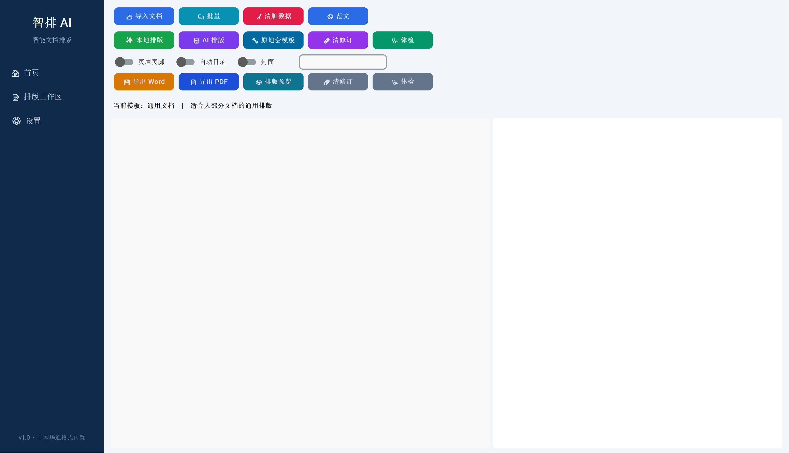
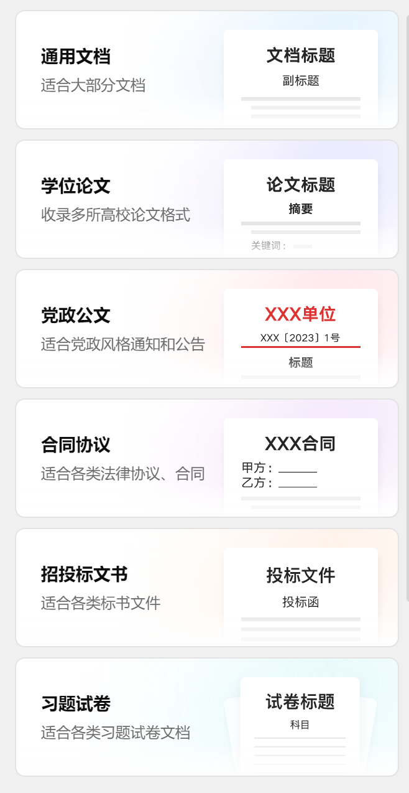

<div align="center">

# 🏛️ 华通智排AI

**通信工程设计文件智能排版工具** · Python + customtkinter + Word COM

[](https://github.com/Mine1178/redesigned-train)
[](https://github.com/Mine1178/redesigned-train)
[](https://github.com/Mine1178/redesigned-train)
[](LICENSE)

</div>

---

## 📖 目录

- [📸 界面预览](#-界面预览)
- [✨ 功能](#-功能)
- [🛠️ 技术栈](#️-技术栈)
- [💻 兼容性与环境](#-兼容性与环境)
- [🚀 快速开始](#-快速开始)
- [📦 打包命令](#-打包命令)
- [🗺️ Roadmap](#️-roadmap)
- [📄 License](#-license)

---

## 📸 界面预览

<div align="center">





</div>

---

## ✨ 功能

- **8 套排版模板**：华通出版、通用报告、工程合同、学术论文、招投标、党政公文、试卷、范文复刻
- **标题智能识别**：一至四级标题（Word 样式名 + 文字正则）
- **批量排版**：自动目录、三段式页码分节、表格统一规范
- **多模型 AI 接入**：OpenAI 兼容协议（通义千问 / DeepSeek / 智谱 / Ollama / vLLM）
- **原地套样式**：保留图片公式，支持 PDF 导出、水印、修订清理
- **细节规范**：孤行控制、图注绑定、自动更新目录域

> 面向通信工程设计文档、工程报告、合同协议、论文与招投标材料的批量 Word 自动排版，减少逐篇调字号、行距、边框与目录的重复劳动。

---

## 🛠️ 技术栈

- Python 3.10
- customtkinter（界面）
- python-docx（文档读写）
- pywin32 / Word COM（原地修改）
- OpenAI SDK（大模型接入）
- requests（模型接口调用）

---

## 💻 兼容性与环境

- **操作系统**：Windows 10 / 11（依赖 Word COM，需安装 Microsoft Word 或 WPS 文字）
- **Python**：3.10 及以上
- **文档格式**：处理 `.docx` 文档；原地套样式通过 Word / WPS COM 完成

---

## 🚀 快速开始

### 源码运行

```bash
git clone https://github.com/Mine1178/redesigned-train.git
cd redesigned-train
pip install -r requirements.txt
pip install pywin32 openai
python main.py
```

> 📦 Windows 安装包将在后续 Release 中提供，当前以源码运行为主。

---

## 📦 打包命令

```bash
pyinstaller --noconfirm --clean --windowed --onefile \
  --icon app.ico --name "华通智排AI" \
  --collect-data customtkinter --hidden-import inplace main.py
```

---

## 🗺️ Roadmap

- [ ] 发布 Windows 安装包（Releases）
- [ ] 配置面板可视化设置字号、行距、边框参数
- [x] 补充界面截图与模板展示
- [ ] 新增更多行业文档模板

---

## 📄 License

[MIT](LICENSE)
